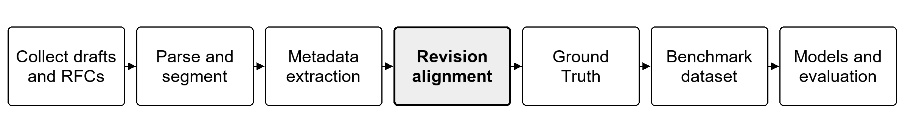
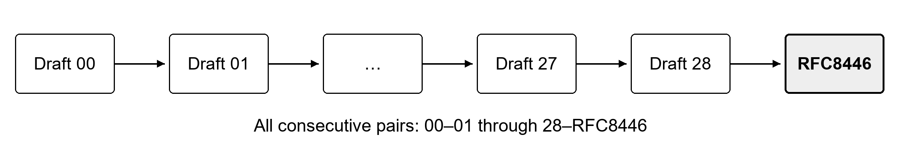
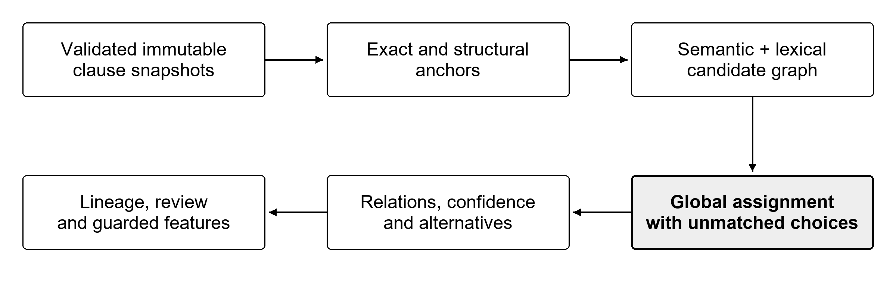
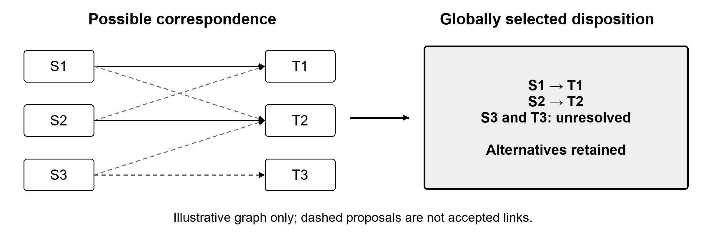
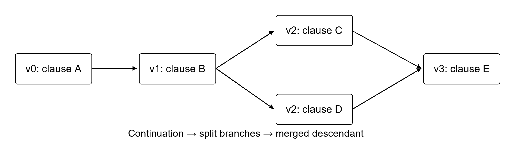
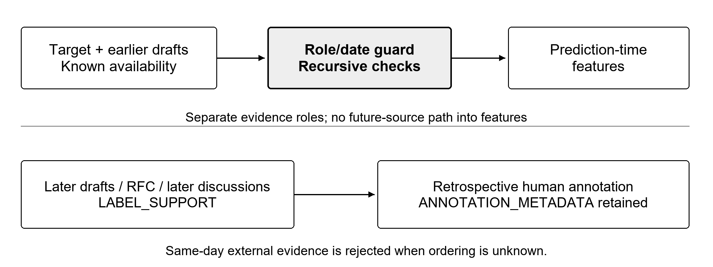
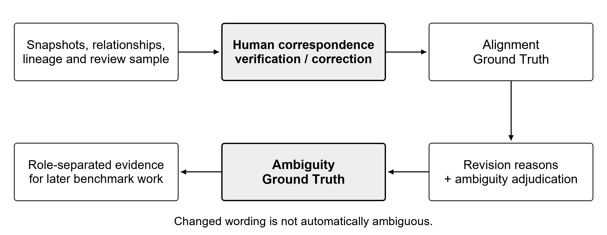

# Revision Alignment for the TLS 1.3 Document Family

The revision-alignment stage receives collected document revisions, parsed and segmented clauses, and document metadata from the preceding collection, segmentation, and metadata stages. It produces correspondence hypotheses between consecutive versions, persistent clause lineages, change indicators, provenance, and review artifacts. These outputs make it possible to trace how a requirement develops without treating every textual edit as evidence of ambiguity. They provide the Ground Truth team with a reproducible starting point for verifying alignment, explaining revision intent, and subsequently assigning ambiguity labels.

## Revision Alignment Overview

Internet-Drafts evolve through corrections, reorganizations, additions, and technical redesign. A clause identifier identifies an occurrence in one source document; it does not, by itself, establish that another occurrence in a later revision expresses the same requirement. Revision alignment supplies that correspondence layer. Without it, downstream annotation may compare unrelated passages or mistake a section renumbering, insertion, split, or merge for a substantive change to a particular requirement.

This chapter concerns correspondence and its engineering validation. It does not repeat the collection protocol, parser design, full ambiguity taxonomy, benchmark design, or model-training methodology assigned to other project stages. The implementation consumes those stages' existing outputs and retains their provenance. Its responsibility is to establish a transparent, revisable connection between clause occurrences and to expose uncertainty wherever correspondence cannot be supported reliably.



Caption: Position of revision alignment in the project pipeline. Only the TLS alignment stage is claimed complete by this chapter.

Three decisions are kept separate. An alignment relationship describes correspondence, such as MODIFIED or SPLIT. A revision reason describes why the author changed the document, such as editorial improvement or ambiguity clarification. An ambiguity label describes whether the assessed clause permits problematic interpretations. Neither alignment scores nor the presence of a change establishes the second or third decision. Similarly, NORMATIVE, CONTEXTUAL, EXCLUDED, and MANUAL_REVIEW describe upstream clause treatment; they are not ambiguity labels.

The implementation was assessed using deterministic tests and an independent artifact audit. Its empirical alignment quality remains unmeasured because no manually verified gold alignment scope was supplied. Throughout this chapter, “validated” refers to the stated software, structural, provenance, or temporal checks, not to human confirmation that every correspondence is correct.

## Scope of the TLS Pilot

The pilot covers one document family: the 29 collected TLS 1.3 drafts, revisions 00–28, followed by RFC8446, the August 2018 TLS 1.3 specification [RA-3]. These form 30 documents and 29 consecutive alignment problems. The endpoint is the historically selected RFC8446; this is not a claim about the latest current TLS specification. The design leaves room for later families, while discovery and orchestration deliberately remain TLS-specific in this milestone.

Included capabilities are input validation, immutable snapshot preparation, conservative normalization, exact and structural anchors, semantic and lexical candidates, globally consistent assignment, basic split/merge/move detection, uncertain alternatives, confidence bands, review routing, lineage, and guarded draft-history features. Missing clause snapshots for TLS-22 and RFC8446 were generated with the existing deterministic parser and segmentation pipeline only inside a new alignment run. No LLM refinement was invoked for those preparations.

Excluded activities are processing another family, ambiguity Ground Truth construction, revision-reason classification, final benchmark assembly, ambiguity-detector training, family-level generalization experiments, and protocol holdout evaluation. The lexical backend supplies a reproducible comparison mode; only the preserved early and late smoke pairs were run in both lexical and semantic modes. A complete lexical timeline comparison was not performed.



Caption: Consecutive version alignment. The ellipsis represents the intervening collected revisions, not omitted pairs.

## Initial Repository and Data State

The repository already contained collection scripts and metadata manifests, TXT/XML structural parsing, and deterministic block-to-clause segmentation. The existing clause schema supplied occurrence identifiers, parent section and block information, original text, source locations, block-relative character spans, references, BCP 14 keywords, classifications, and classification evidence. These abstractions were reused rather than silently replaced.

The preferred updated input collection contained 28 TLS snapshots. TLS-22 and RFC8446 did not have corresponding preferred clause snapshots. Older deterministic clause outputs also existed, but the alignment runner does not silently substitute them for updated classifications. The two missing snapshots were prepared in the run directory and marked as prepared. This makes their different classification provenance visible to reviewers. All other snapshots preserve the existing rule and LLM extension fields through the clause adapter.

Occurrence IDs remain specific to document, section, block, and clause position. They are stable for the same parsed source but are not assumed to persist unchanged across revisions. An independent lineage identifier supplies continuity after alignment. The adapter also checks that clause document/revision identities agree with their envelope and that the character-span length equals the original text length.

Document metadata presents two temporal limitations. Draft dates have day-level precision, and revisions 00 and 01 share the same submission date, 17 April 2014. RFC metadata has month-level precision: a first-of-month value is not treated as an exact publication timestamp. The RFC's conservative availability bound is the end of its reported month. The final-draft association is checked against RFC metadata. The shared draft–RFC link manifest was empty at chapter inspection; the TLS runner therefore relies on the explicitly checked RFC record, rather than claiming an independently populated link table.

Initial reproducibility constraints included an existing Windows Conda environment, previously generated user data, a pinned local embedding model, and preserved partial runs. The implementation had to avoid overwriting any existing clause output, silently downloading a different model revision, or treating a partially written run as successful. Appendix A identifies reused and added files; appendices I–K separate retained development evidence from facts that cannot be reconstructed from raw logs.

## Alignment Methodology

### Document-family timeline construction

The timeline is constructed from the TLS metadata record. Revisions are sorted numerically and must form a complete sequence beginning at 00; gaps, duplicate revision numbers, and non-numerical identifiers fail clearly. Submission dates must not decrease as the revision number increases. Consecutive pairs are formed after validation. Equal dates are permitted for validated numerical predecessors; chronology is not fabricated at an hour or minute resolution.

RFC8446 is appended only when its metadata associates it with the last collected draft and its publication month follows the final draft under the implemented conservative check. A conflicting association or date requires better evidence. The reusable conceptual contract does not assume that every draft family becomes an RFC, although this pilot's expected complete timeline contains RFC8446.

### Immutable input snapshots

The runner rejects an existing output directory. It writes a request record before processing and then stores one enriched snapshot per input document through exclusive file creation. Original raw-source and preferred-input hashes are retained separately from each serialized snapshot hash. Prepared snapshots identify their raw source and deterministic origin; they do not claim LLM refinement.

Immutability here is an application-level exclusive-write policy backed by hash audits, not an operating-system read-only lock. A user could still edit a file externally, but the recorded hashes expose such changes. Failed and stopped directories are retained and never reused for a later attempt. Embedding caches are separate, content-addressed resources whose stored arrays are verified before reuse.

### Clause adaptation and enrichment

The clause adapter preserves the existing segmentation fields and accepts extra classification/provenance fields for backward compatibility. A document envelope adds family identity, revision, publication and availability dates, date precision, source/input hashes, and preparation status. It checks unique occurrence IDs and positions, ordered positions, nonempty text, and identity consistency. Gaps in clause position values are not equated with missing draft revisions.

The adapter does not invent correspondence from an occurrence ID. It retains section paths, block types, references, BCP 14 keywords, and source locations as evidence for scoring and review. Classification transitions are reported for human attention; they do not automatically become revision reasons or ambiguity findings.

### Conservative normalization

Normalization uses Unicode NFC and consistent line endings. Prose receives whitespace consolidation. An explicit leading list bullet may be removed, while numerical and alphabetical markers remain because they may be protocol identifiers. Artwork, source code, tables, and formal syntax retain multiline structure; trailing spaces are removed conservatively. Both original and normalized text remain available.

The alignment normalizer does not independently strip arbitrary headers or footers: presentation-noise handling belongs to the reused parser. It does not lowercase the stored normalized text, remove negation, erase numbers, or collapse modal distinctions. Preserving BCP 14 capitalization supports inspection of requirement strength [RA-1, RA-2]. Lexical and signature components may case-fold their own comparison tokens without rewriting the preserved source.

### Structural correspondence

For each source section heading, candidate retrieval identifies the most similar target heading and includes nearby target sections. Ties use deterministic section order. Section identifiers and paths are preserved, but the implemented weighted structural score is section-heading similarity, not a separate learned or path-based structural model. Renumbering alone therefore does not determine correspondence.

Block compatibility is 1.0 for identical block types, 0.8 across paragraph/list-item/definition combinations, and zero for other type changes. Incompatible candidates are discarded. Relative clause position provides a weak preference, not an absolute monotonicity constraint. This allows strong correspondence to survive document reorganization.

### Exact anchors

Normalized exact-text matches are retrieved explicitly. A match is locked only when its text is unique on both sides, it contains at least six distinctive content tokens, and its structural score is exactly one. Short or repeated boilerplate is not locked merely because identical wording occurs in both versions. Other exact matches remain candidates and can be displaced or marked uncertain.

Exact candidates receive a combined score of one, but that score is not a calibrated probability. A locked anchor can still have review reasons, including a classification transition or a detected movement. An effectively unchanged text can therefore require review even when its correspondence is straightforward.

### Semantic candidate matching

Retrieval is bidirectional. Each direction searches heading-corresponding and nearby sections first, then adds controlled document-wide candidates to recover moved clauses. The semantic mode uses local and global embedding ranks, a lexical-overlap union, and exact matches. The lexical mode uses reproducible content-overlap rankings without loading a model. Both directions are combined into a deterministically ordered graph.

Defaults retain local top-10 and global top-5 retrieval contributions with a neighboring-section window of one. Because the graph is a union of several retrieval routes and both directions, this does not impose a strict final degree of fifteen candidates per clause. Component scoring and the candidate floor remove weak edges afterward. A candidate is a possible relationship, not an accepted link.



Caption: Architecture of the implemented stage. Candidate generation and relationship decisions are separate operations.

### Scoring components

Each one-to-one candidate stores semantic, lexical, structural, relative-position and block-compatibility scores, together with actor, modal, negation, number, identifier, condition, and reference consistency. Missing semantic scores are null in lexical mode. The protected-information contribution averages the seven consistency measures; a changed number or actor reduces correspondence evidence modestly rather than proving that the clauses are unrelated.

Caption: Default weighted correspondence components. Settings are development choices requiring later calibration.

| Component | Weight | Implemented interpretation |
|---|---:|---|
| Semantic | 0.38 | Nonnegative cosine similarity between normalized clause vectors |
| Lexical | 0.38 | 0.6 multiset token overlap plus 0.4 character similarity |
| Structural | 0.12 | Case-folded section-heading similarity |
| Position | 0.04 | One minus normalized positional distance |
| Block | 0.04 | Identical or compatible block-type evidence |
| Protected information | 0.04 | Mean actor/modal/negation/number/identifier/condition/reference consistency |

The combined score is the weighted mean over available components. The semantic weights sum to one; lexical mode renormalizes over the remaining terms. Token multiset overlap is twice the shared token count divided by the total token count. Character and heading similarity use RapidFuzz ratios. Set consistency uses intersection over union, with two empty sets treated as agreement. This last convention can make sparse evidence look consistent, so a high protected score is not proof that all relevant protocol semantics were extracted.

The token and signature rules preserve useful protocol cues, including hexadecimal constants and selected actor/condition terms, but they are surface heuristics. They do not perform full role resolution, logical equivalence checking, or protocol field parsing. All components remain available for error analysis rather than being hidden behind a single score.

### Embedding model

The semantic backend uses the generic all-MiniLM-L6-v2 sentence-transformer model, whose published model card describes 384-dimensional sentence and short-paragraph embeddings [RA-5]. The use of comparable sentence vectors follows the sentence-embedding approach described by Reimers and Gurevych [RA-4]. The pilot selected a compact, locally executable model rather than training a TLS-specific encoder.

The exact model revision is 1110a243fdf4706b3f48f1d95db1a4f5529b4d41. The model artifact records all snapshot file hashes, tokenizer metadata, package versions, CPU execution, batch size 32, overlap 32, and the effective token limit. The final run loaded a local snapshot without hosted inference calls. A modern encoder's historical training corpus may contain later standards material; input-date guards do not remove that distinct contamination risk.

### Long-clause windowing

The model's effective sequence limit is the minimum finite limit declared by the sentence-transformer wrapper, tokenizer, and underlying transformer capacity. The final model limit is 256 encoded tokens. Two required special tokens leave 254 content-token positions. Each clause is tokenized once into original IDs and partitioned into overlapping windows of at most 254 IDs, with 32-token overlap and a nominal stride of 222.

Prepared token-ID features are forwarded directly through the encoder module stack. The implementation does not decode a window and assume retokenization preserves its length. Special-token construction is checked against the supported BERT template when the installed tokenizer lacks the legacy preparation API. Each prepared window and padded batch must fit the effective limit; failures are explicit, not silent truncation.

For the original TLS-08 regression clause, 935 source IDs are covered by five half-open intervals: [0,254), [222,476), [444,698), [666,920), and [888,935). Encoded lengths are 256, 256, 256, 256, and 49. Source bounds, content-token hashes, clause ownership and encoded lengths are saved. The next start strictly advances, and processing terminates when the end reaches the source length. Empty or whitespace-only clauses are errors; empty batches are supported.

Each window vector is normalized; vectors belonging to a clause are summed and normalized again. This retains complete token coverage but is still approximate pooling. It does not restore interactions across distant windows, and overlap can weight repeated context more strongly. The final audit checks the preservation claim, not semantic equivalence of pooled embeddings to an unlimited-context model.

### Global assignment

After anchors are locked, eligible candidates are decomposed into connected components. Unrelated sources cannot independently claim the same target. Components with only one-to-one edges use rectangular bipartite assignment with dummy unmatched choices. SciPy's implementation is a modified Jonker–Volgenant solver [RA-6]; “Hungarian/bipartite” describes the approved assignment family, not a claim that a custom Hungarian algorithm was implemented.

Competing split/merge hypotheses require binary decisions with one-use constraints for every endpoint. Those components use SciPy's mixed-integer linear programming interface to HiGHS [RA-7]. The gain of an edge with source set S and target set T is:

```text
gain = (|S| + |T|) / 2 * (combined_score - match_floor)
       - group_penalty * (|S| + |T| - 2)
```

Gains are rounded to six decimal places and receive a small ordered secondary preference. The solver maximizes eligible gain with endpoint non-overlap constraints; this is global consistency within the generated candidate graph, not an exhaustive search over every possible semantic correspondence. A non-optimal solver result raises an error rather than silently falling back. Fixed ordering and versions support repeatability on the tested environment, but unique outcomes across all solver versions and platforms are not proven.



Caption: Candidate proposals versus globally selected correspondence. Dashed alternatives are not additional accepted links.

### Insertions and deletions

Clauses left without selected correspondence receive explicit dispositions. If a strong competing candidate remains, the residual is UNCERTAIN rather than forced into an insertion or deletion. Otherwise, a source-only occurrence is DELETED and a target-only occurrence is INSERTED. Each occurrence receives one disposition per applicable pair, including unmatched cases.

These labels remain hypotheses. A missed retrieval candidate can resemble a deletion or insertion, so both residual categories are routed to review. Full endpoint accounting demonstrates structural completeness, not that every apparent insertion or deletion is correct.

### Split and merge detection

The implementation tests one clause against adjacent groups on the opposite side, in both directions. Groups are restricted to one section and compatible prose block types, with a default maximum size of three. Bidirectional lexical coverage must reach 0.75; each member must have at least four content tokens, meet 0.55 coverage against the single clause, and contribute tokens not supplied by the other members.

These checks reduce accidental grouping of repeated protocol terminology. Candidate text is concatenated for lexical comparison; group semantic vectors are normalized sums of existing member embeddings, not newly encoded concatenated text. A complexity penalty favors simpler correspondence unless the group provides sufficient additional gain. Many-to-many rewriting is not modeled directly and may remain uncertain.

### Moved-clause detection

Movement uses section-title correspondence elsewhere in the target or inversion relative to at least two reliable anchors. A changed section number alone is insufficient. A one-to-one relationship with movement evidence becomes MOVED, while a split or merge retains its primary relation and stores movement metadata separately. Textual change is also recorded independently.

This is a heuristic measure of structural relocation. Large reorganizations can create many move predictions, and heading changes or broad anchor inversions can be misleading. All moved cases enter the review queue; their count is not evidence of correctness or ambiguity.

### Uncertain relationships

For selected nonlocked edges, the candidate margin compares the selected score with the strongest competing edge sharing any endpoint. A margin below 0.025 changes the relation to UNCERTAIN. The margin is local competing evidence, not a posterior probability or the loss from removing the edge from the full optimization problem.

Up to three alternatives are retained in a relationship record, while the full candidate graph remains available separately. An uncertain record with multiple endpoints does not assert every Cartesian-product link. Uncertain ancestry is not silently converted into a lineage continuation, and ambiguity labels are never generated from uncertainty in the alignment algorithm.

### Confidence and manual-review routing

HIGH requires a non-uncertain selected edge with score at least 0.88 and either a lock or margin at least 0.12. Other selected non-uncertain edges receive MEDIUM; uncertain and unmatched records receive LOW. These are explicit uncalibrated rule bands, with calibrated probability left null.

Review is required for complex, moved and uncertain relations, class transitions, unresolved upstream clause classifications, changes to actors/modals/negation/numbers, and residual insertion/deletion cases. Non-high cases without another reason receive an unvalidated-confidence reason. A deterministic hash-based five-percent audit samples high-confidence records. Thus HIGH and review-required are compatible: review can be required for semantic importance or provenance concerns even when correspondence looks strong.

The 150-record pilot sample is selected across relation/confidence strata with seed 17. It provides review coverage, not a representative prevalence estimate. The full queue and the sample preserve endpoint clauses, alternatives and empty human-review fields. Automatic correction application is not implemented; reviewers must create a separate annotation copy.

### Clause lineage construction

Lineage is built forward in validated document order. Accepted one-to-one unchanged, modified and moved continuations retain a lineage identity. Splits and merges create descendant identities with explicit parent information. A later merge does not rename earlier nodes, and uncertain correspondence starts an uncertain history rather than fabricating parents.

Nodes retain occurrence IDs, revisions, availability, incoming alignment references and source hashes. Pairwise records receive the relevant lineage IDs. Reviewers can therefore inspect a local relationship and trace its earlier context without losing the original occurrence identifiers. Tests verify that appending later documents does not retroactively change an earlier lineage prefix.



Caption: Illustrative lineage through continuation, split and merge. Letters are synthetic examples, not measured TLS clause IDs.

### Revision-aware feature generation

For a target draft, feature extraction first obtains an admissible prefix of documents and alignment records. Basic features include prior observed edit events, uncertainty and history-completeness flags, revisions observed, elapsed document age, previous lexical/semantic distance, and surface change flags. Shared ancestral events are counted once across merges. The count includes observed changes up to the target revision and excludes insertions and unresolved changes as asserted edit events.

Uncertain ancestry produces null edit counts rather than false certainty. Previous distances are unavailable when no reliable prior correspondence exists. Features retain dependency document IDs and source hashes for audit. More elaborate maturity or stability measures are not claimed implemented simply because they appear in the broader project proposal.

### Temporal-leakage prevention

Prediction-time evidence must have role MODEL_FEATURE, known availability no later than the target's publication date, and admissible dependencies. LABEL_SUPPORT and ANNOTATION_METADATA are separate roles and are rejected by the feature guard. Undated or future evidence fails clearly. Draft features exclude RFC8446 and outgoing future alignment edges, even though those artifacts are useful for retrospective annotation.

Validated same-family numerical predecessors may be admitted on the same submission date. This resolves TLS-00 before TLS-01 without inventing timestamps. Same-day external evidence remains inadmissible when intra-day ordering is unknown. Local reference resolution selects an admissible historical catalog version rather than automatically fetching the latest document; missing or symbolic references remain unresolved.

Reviewed offline alignments cannot replace automatic prediction history without an evidence policy: the current prefix view rejects non-NOT_REVIEWED records. No actual days remaining to RFC, final revision count, future stability, later discussion, revision reason, or publication outcome is emitted as a prediction feature. Passing these explicit guards does not establish purity of pretrained model data.



Caption: Separation of prediction evidence from retrospective label support. Date and role checks apply recursively to feature dependencies.

## Implementation

### Package architecture and public interfaces

The package separates contracts and configuration from input preparation, representation, retrieval, selection, relationship decisions, and downstream outputs. The runner validates and snapshots inputs first, preflights every draft prefix, initializes the selected representation backend, and then processes consecutive pairs. Candidate generation returns graph edges; selection returns non-overlapping choices and solver diagnostics; relationship construction adds uncertainty, confidence, alternatives and provenance. Lineage and review artifacts are assembled before guarded features and the final manifest.

Public interfaces support both the CLI and direct Python use: timeline construction and input preparation; normalization; an Embedder with an encode operation; candidate_graph; select; records; build_lineage; prediction_view and guard; features; evaluate; and validate_run. These interfaces reuse the existing parser and segmenter. The only change to their existing model declaration was to acknowledge the already-emitted formal_syntax block type. Appendix B gives the complete callable reference.

### Configuration and command-line integration

The CLI accepts a new output directory, an optional configuration file, backend selection, a pinned model revision, explicit download permission, missing-input preparation, preparation-only operation, a consecutive smoke pair, and optional reviewed gold. Defaults are validated through the typed configuration class. Unknown fields, nonfinite values, inconsistent thresholds and invalid group/window bounds are errors.

The final run used semantic mode with a pinned local model and explicit missing-input preparation. Lexical mode never initializes the model. All configuration values are stored in the request and manifest, and relationships record a canonical configuration hash. Appendix C supplies commands; Appendix D lists every default and the final override. The documentation does not imply that merely installing model libraries implements an ambiguity detector.

### Serialization, schema and provenance

JSON and JSONL use a versioned, canonical representation with sorted keys, UTF-8 text, compact separators and nonfinite-number rejection. Document, Clause, Alignment and Evidence contracts validate their defined boundaries. Raw alignment records reject unexpected ambiguity-label or revision-reason fields. Candidate, lineage, feature and review bundles are versioned outputs but do not all share the same Pydantic validation contract; this distinction matters for downstream consumers.

An alignment stores endpoint lists, document/revision identities, dates, relation, text and movement indicators, component scores, confidence, review state/reasons, alternatives, lineage IDs, change flags, provenance, algorithm version and creation time. Stable relationship identifiers are derived from endpoints and relation rather than execution timestamps. Runtime timestamps and local provenance paths mean complete files are not promised byte-identical across executions. Appendix E describes the full contracts and derived formats.

### Logging, diagnostics and manifests

Each pair logs endpoint documents, clause counts, duration and relationship counts. Solver diagnostics identify locked anchors and component types. A failed stage writes a detailed record with stage, current document/pair, completed-pair information, configuration and traceback when the exception is handled by the runner. A stopped process can require an externally written stop record; preserved records distinguish that case.

The completed manifest records schema/algorithm versions, configuration, metadata hashes, source/input/snapshot hashes, package versions, code hashes captured at run start and checksums of the generated artifacts. It is written after successful outputs and source-integrity checks. The standalone audit verifies those artifacts independently of the execution log. An immutable run is not declared successful merely because some pair files exist.

### Review and correction workflow

Review bundles include original endpoint records, alternative correspondence and review reasons. The review status and proposed human fields are not automatic labels. Reviewers should annotate separate copies, retain record and occurrence IDs, and record reviewer identity, time, corrected endpoints, relation and rationale. The current implementation can accept explicitly reviewed complete pair scopes for metrics but does not apply corrections back into automatic lineage or regenerate benchmark data.

Alignment Ground Truth must therefore be treated as a new versioned annotation product. Later revision-reason and ambiguity annotations should join to verified occurrence relationships, retain their evidence roles, and document disagreement and adjudication. The immutable automatic output remains the baseline against which corrections and operational workload can be assessed.

## Problems Encountered and Corrections

The chronology below follows the recoverable implementation sequence. The preserved failure records and successful artifacts support the stated outcomes. Exact native crash stacks and every intermediate shell invocation are not retained; those absences are identified rather than reconstructed as facts. Appendix J gives an issue-by-issue symptom, impact, correction, test and artifact-disposition matrix.

### Windows numerical-library loading

Direct Python execution in the Windows environment could select incompatible native-library paths, and loading the model stack before PyArrow exposed a native import crash. Such a failure could terminate the process outside the runner's Python exception handler. Conda activation/run supplies the environment paths, and the semantic backend initializes PyArrow before torch and sentence-transformers on Windows. No installed package was patched.

There is no isolated unit test that recreates the low-level native crash. Verification consists of the real pinned-model regression and successful semantic smoke/full runs in the environment. This is an environment-specific mitigation, not a universal proof about every Windows installation. Previous incomplete artifacts were retained; no result from a crashed initialization was promoted to a successful run.

### Initial token-window overflow and API compatibility

The first full attempt completed seven pairs before revision 08 exposed a long-clause failure. A decoded 254-ID window retokenized to more content IDs than the available budget allowed. Adding special tokens exceeded the model's effective limit. Silent truncation would have damaged correspondence evidence and window provenance, so the run stopped and retained its failure record.

The real 935-token clause became a deterministic fixture. An intermediate window-regression smoke run was preserved, but final inference uses original token-ID windows directly. The installed tokenizer API also lacked the legacy preparation method; the correction supports it when present and otherwise validates and constructs the pinned single-sequence BERT template. Unsupported templates fail explicitly. Tests cover the actual expansion, all boundary cases, direct-ID inference and complete coverage. Earlier embedding policies retain separate cache identities and are not reused by the final direct-ID policy.

### Same-day draft chronology

A later full attempt was stopped after 15 pairs when the temporal audit found that a conservative same-day external-evidence rule also rejected TLS-00 as history for TLS-01. Both have the same submission date, but numerical revision order is known. Leaving the rule unchanged would block valid feature generation; relaxing it for all same-day evidence would admit unknown external ordering.

The correction admits only validated earlier numerical revisions of the same family on that date, retains the rejection of same-day external evidence, and preflights all target prefixes before embedding. A regression uses the actual TLS-00/01 date and rejects a later same-day revision and same-day external evidence. The stopped run remains incomplete, and subsequent runs use a new directory.

### Python hash-order candidate ties

Another attempt was stopped after 16 pairs when equivalent cached inputs yielded a small insertion/uncertainty difference. Equal lexical-overlap candidates inherited Counter insertion order from hashed token-set traversal. Changing the process hash seed could therefore change the retrieved graph before optimization.

Candidate ties now use explicit positional ordering, and candidate edges and solver inputs are ordered deterministically. A regression compares candidate/scoring digests in three subprocesses with different Python hash seeds. The final suite and run passed. The earlier stopped run and completed caches were preserved; the prior graph is not represented as the final reproducible output. This test verifies the discovered retrieval issue, not an exhaustive cross-platform equivalence claim for every solver decision.

### Standalone audit padding

The final alignment run completed successfully, but its first independent token audit reported truncation for the first TLS-00 clause. The saved tokenizer configuration contained fixed padding to 128 tokens. The audit disabled truncation but initially retained padding, whereas inference produced 18 actual source IDs for that clause. Their hash already matched the saved window exactly.

The audit now disables both serialized padding and truncation. A synthetic serialized-tokenizer regression reproduces padding expansion and tests short, empty and 935-token inputs. The focused suite, full suite and corrected full audit passed. No alignment artifact was regenerated: the original manifest retains its run-start validator hash, while an external successful validation record stores the corrected validator hash. A separate external failure record preserves the false alarm.

## Testing and Validation

### Verification strategy

Synthetic fixtures isolate normalization, component scores, retrieval, assignment, unmatched cases, split/merge/move rules, boilerplate ambiguity, contracts and malformed inputs. Integration fixtures exercise successive revisions, exclusive output directories, consolidated/per-pair consistency, failure records and lineage-prefix stability. Temporal tests cover role/date rejection, recursive dependencies, references and same-day policies. Parametrization explains why the number of executed cases exceeds the number of test functions.

The real-model regression uses the pinned local MiniLM and actual TLS-08 fixture, including punctuation-heavy protocol text. It never downloads weights during a test and is designed to skip elsewhere if the snapshot is absent; it did not skip in the verified environment. Cross-process tests vary the Python hash seed. Assignment/group tests verify non-overlap and intended synthetic choices. None of these fixtures is human-reviewed TLS gold.

### Final recorded test results

Caption: Final verified software checks. These establish software behavior, not alignment precision or ambiguity accuracy.

| Check | Recorded result |
|---|---|
| Complete test suite | 121 passed; 2 warnings; 11.76 seconds; no failures or skips |
| Focused embedding/window suite | 29 passed; 2 warnings; 6.11 seconds; no failures or skips |
| Ruff checks | Passed |
| Git whitespace checks | Passed; only line-ending conversion notices |
| Independent completed-run audit | PASS for hashes, endpoints, lineage, features and all windows |
| Protected original inputs | 394 files unchanged; no additions or removals in protected directories |

The two warnings concern third-party SwigPyPacked and SwigPyObject types lacking a module attribute. They are deprecation warnings, not skipped tests or solver errors. The report preserves recorded historical results rather than rerunning the computational pipeline while writing this chapter. Appendix K lists the complete reconstructable command/result history and its evidence limits.

### Independent artifact validation

The completed-run audit checks the complete manifest and its artifact hashes, expected TLS timeline, prepared-document set, unique relationship IDs, and one disposition per source/target occurrence in each pair. It checks per-pair versus consolidated alignments, candidate counts, nonempty lineage references, review queue membership, the unique unlabeled sample, lineage occurrence coverage, draft-only feature files and prefix dependencies.

For the semantic outputs it verifies model artifacts and retokenizes every original normalized clause with padding and truncation disabled. Saved token bounds, content hashes, special-token budgets and complete coverage must agree. Protected input hashes are compared with the baseline. These tests are deliberately independent of the aggregate report counters, but they remain structural and computational checks rather than semantic adjudication.

## Final TLS Run

The successful immutable run is identified as pilot-semantic-v5. It contains all 30 documents, 29 consecutive pairs and 52,137 clause-version occurrences. The full repository-relative location and artifact access points are provided in Appendix L. The recorded run produced 52,953 relationship records, 877,103 candidate hypotheses, 52,137 lineage nodes and 50,138 draft feature rows across 29 files. RFC8446 contributes alignment and lineage evidence but no draft prediction feature file.

The reported pipeline runtime is 693.60 seconds. Seventeen document embeddings were loaded from verified caches; thirteen were newly encoded. The sum of recorded pair times is 655.63 seconds. Pair timers cover target embedding, retrieval, selection and relationship construction before pair serialization. The total report timer ends before final manifest hashing. This is a mixed-cache operational measurement, not a cold-start benchmark; Appendix H retains every pair's exact recorded duration and counts.

All solver components reported optimal results: 10,576 bipartite components and 619 complex components, with 30,345 locked anchors. There were no solver failures, fallbacks, skipped pairs or skipped clauses. Input warning lists and feature diagnostics are empty. TLS-22 and RFC8446 were prepared only inside the run, and all 394 protected original files remained unchanged.

The run contains 1,501,382 original source tokens and 52,361 validated windows. There are 171 long-clause instances, including 72 in cached documents and 99 newly encoded instances. The longest clause contains 1,004 tokens. Every encoded window fits 256 tokens including special tokens, and every source token is covered. The count of long instances describes all observed clause versions, not only fresh encoder work.

## Alignment Results

Caption: Provisional relationship distribution across 29 consecutive pairs. Percentages use 52,953 records as the denominator.

| Relationship | Count | Percentage |
| --- | --- | --- |
| UNCHANGED | 36,592 | 69.10% |
| MODIFIED | 4,452 | 8.41% |
| INSERTED | 2,356 | 4.45% |
| DELETED | 2,025 | 3.82% |
| SPLIT | 261 | 0.49% |
| MERGED | 260 | 0.49% |
| MOVED | 1,808 | 3.41% |
| UNCERTAIN | 5,199 | 9.82% |
| Total | 52,953 | 100.00% |


These counts sum to 52,953. They describe correspondence records across versions, not the number of distinct semantic requirements and not ambiguity prevalence. Insertions and deletions create endpoint-only records, while split and merge records contain multiple occurrences. The relationship count therefore need not equal the number of document clause occurrences.

Caption: Uncalibrated confidence-band distribution over the same 52,953 relationships.

| Confidence | Count | Percentage |
| --- | --- | --- |
| HIGH | 41,377 | 78.14% |
| MEDIUM | 1,996 | 3.77% |
| LOW | 9,580 | 18.09% |
| Total | 52,953 | 100.00% |


Confidence counts also sum to 52,953. HIGH is an explicit rule band, not an estimated probability of correctness. A review reason may coexist with HIGH when a relation is complex, moved, crosses classes or changes protected information. Consequently, the 26,884 review-required records—50.77% of all relationships—must not be interpreted as errors or ambiguous clauses.

The 150-record sample is unlabeled and stratified by relationship/confidence combination. It contains 58 HIGH, 57 MEDIUM and 35 LOW records. It is designed to expose different failure modes and review needs, not estimate a population proportion without weighting. The full review queue remains available beyond the sample. The 5,199 UNCERTAIN records represent unresolved correspondence decisions requiring particular attention.

Every endpoint occurrence receives a disposition in its applicable pair. The accepted correspondence relationship rate is 81.91%, excluding INSERTED, DELETED and UNCERTAIN records; this is an operational coverage definition, not precision. Link precision, recall, F1 and candidate recall remain null. The current evaluator requires reviewer identity and complete reviewed document-pair scopes; a partial sample cannot establish full recall by marking itself complete.

## Reproducibility and Integrity

Reproduction depends on input identity, algorithm/configuration identity, model artifacts, candidate ordering, numerical environment and output provenance. Canonical hashes identify configuration and cache content. Model revision and artifact hashes pin the actual resources. Explicit candidate ordering removes the discovered process-hash dependency, while sorted solver components, quantized gains and small secondary preferences reduce numerical tie instability. These controls support the tested environment; they are not a proof of identical optimization choices under all future numerical-library versions.

Run directories are exclusively created and retained after failure. Original sources, preferred clause files and snapshot hashes have distinct roles. The manifest contains 185 generated-artifact checksums; it does not recursively hash itself. Token windows record source bounds and token hashes, permitting an independent no-truncation check. A separate protected-file baseline verifies the 394 original files. Cache validation does not overwrite completed run outputs.

The final validator correction occurred after the successful run. Its implementation hash therefore differs from the run-start validator hash in the immutable manifest. The external validation sidecar records the corrected hash instead of rewriting the original provenance. This is an explicit audit-version distinction, not a hidden change to the alignment algorithm. Appendix M provides reproducibility checks and Appendix L identifies the machine-readable evidence.

Generated corpus and alignment artifacts are ignored by Git. The code commit includes the module, tests, documentation and regression fixture, but a repository checkout alone does not contain the full successful run, preferred clause inputs or local model weights. The Ground Truth team needs the separately supplied immutable artifacts and hashes. This chapter supplies their inventory rather than claiming that a Git push published those datasets.

## Limitations

The pilot contains one TLS document family. It cannot support document-family generalization, cross-family temporal claims or protocol-family holdout results. A complete timeline is useful engineering evidence but is not a representative cross-protocol sample. No manually verified Alignment Ground Truth has yet been supplied, so measured precision, recall, F1, relation accuracy and candidate recall remain pending.

Confidence thresholds and scoring weights are development defaults. The 50.77% review rate is a substantial operational workload, not a calibrated estimate of the number of errors. Short generic wording, repeated boilerplate, section restructuring, many-to-many rewrites and missed retrieval candidates remain likely error-analysis categories. Split/merge coverage checks reduce generic grouping but do not establish semantic equivalence.

TLS-22 and RFC8446 have deterministic classification provenance, whereas the preferred neighboring snapshots include LLM refinement. These differences can affect review transitions and segmentation comparability. Upstream labels are not human ambiguity judgments. Field, actor and condition signals are sparse surface evidence; reference catalogs and symbolic bibliography expansion remain incomplete.

MiniLM is a generic sentence encoder. Its short-text training, approximate window/group pooling and potential exposure to later standards in pretraining limit historical interpretation. Date guards prevent explicit future source evidence from entering emitted features, but do not prove that pretrained weights were available or uncontaminated at historical prediction dates. Day/month precision and missing intra-day ordering impose additional restrictions. Automated reviewer-correction application and confidence calibration also remain future work.

## Handover to Ground Truth

The receiving team obtains versioned clause snapshots, pairwise relationships and alternatives, persistent lineages, text/movement/change indicators, uncalibrated confidence, review reasons, temporal/source provenance, guarded revision features and a 150-record review sample. These products connect clause occurrences and expose uncertainty; they do not decide why a clause changed or whether it was ambiguous.



Caption: Ground Truth handover. Alignment Ground Truth and Ambiguity Ground Truth are separate annotation products.

The required receiving workflow is:

1. Verify or correct endpoint membership and alignment relationships using source context and alternatives.
2. Create human-reviewed Alignment Ground Truth, retaining reviewer identity, date, rationale, disagreements and adjudication.
3. Annotate revision reasons independently of correspondence.
4. Determine whether an observed revision is an ambiguity clarification or another type of change.
5. Assign AMBIGUOUS, CLEAR or UNCERTAIN labels to the relevant assessed clause, with supporting evidence.
6. Preserve label-support evidence and annotation metadata separately from prediction-time evidence.
7. Measure alignment quality before relying on automatic alignment as benchmark infrastructure; obtain complete reviewed scopes for recall.

Alignment verification is the first part of the Ground Truth workflow. A changed clause is not automatically ambiguous, and absence of an erratum is not proof of clarity. Later drafts, RFCs and discussions may support retrospective labels, but cannot enter earlier prediction-time features. The handover checklist in Appendix N defines the exact artifact and annotation checks required before those outputs are promoted to benchmark evidence.

## Conclusion

The TLS-only revision-alignment MVP is technically complete and independently validated within the checks described in this chapter. It provides the versioned clause relationships, lineage, provenance and review artifacts required by the Ground Truth stage. Human alignment evaluation, confidence calibration, ambiguity labeling and cross-family validation remain pending. The reported relationship distributions characterize provisional correspondence and workload; they do not establish alignment accuracy or ambiguity prevalence.

### Ground Truth handover status

The automatic TLS alignment package is ready for transfer with its manifest, input snapshots, complete relationship/candidate outputs, lineage, guarded features and review artifacts. The receiving team should begin by verifying the unlabeled sample and establishing a separately versioned Alignment Ground Truth dataset. No automatic relationship, confidence band or change indicator should be promoted to an ambiguity label without the subsequent evidence-based annotation steps.

## Sources Used in This Chapter

Chapter-local reference keys are temporary merge identifiers. Bibliographic details follow the bracketed-reference convention used in the project proposal and literature review; the final editor can deduplicate and renumber them without changing the project-wide bibliography here. Research and official technical sources are listed below. Repository implementation evidence is catalogued separately in the appendices and is not presented as an academic publication.

[RA-1] S. Bradner, “Key words for use in RFCs to Indicate Requirement Levels,” RFC 2119, March 1997. DOI: 10.17487/RFC2119. https://www.rfc-editor.org/rfc/rfc2119.html

[RA-2] B. Leiba, “Ambiguity of Uppercase vs Lowercase in RFC 2119 Key Words,” RFC 8174, May 2017. DOI: 10.17487/RFC8174. https://www.rfc-editor.org/rfc/rfc8174.html

[RA-3] E. Rescorla, “The Transport Layer Security (TLS) Protocol Version 1.3,” RFC 8446, August 2018. DOI: 10.17487/RFC8446. https://www.rfc-editor.org/info/rfc8446/

[RA-4] N. Reimers and I. Gurevych, “Sentence-BERT: Sentence Embeddings using Siamese BERT-Networks,” Proceedings of EMNLP-IJCNLP, 2019, pp. 3982–3992. DOI: 10.18653/v1/D19-1410. https://aclanthology.org/D19-1410/

[RA-5] Sentence Transformers, “all-MiniLM-L6-v2,” model card, Hugging Face. Consulted 9 September 2026. https://huggingface.co/sentence-transformers/all-MiniLM-L6-v2. The execution revision and artifact hashes are taken from the retained model record, not inferred from the current model-card page.

[RA-6] SciPy community, “scipy.optimize.linear_sum_assignment,” SciPy 1.17.0 reference documentation. Consulted 9 September 2026. https://docs.scipy.org/doc/scipy-1.17.0/reference/generated/scipy.optimize.linear_sum_assignment.html. The run used patch release 1.17.1.

[RA-7] SciPy community, “scipy.optimize.milp,” SciPy 1.17.0 reference documentation. Consulted 9 September 2026. https://docs.scipy.org/doc/scipy-1.17.0/reference/generated/scipy.optimize.milp.html. The run used patch release 1.17.1.


## Appendix A: Complete file inventory

Paths in technical appendices are repository-relative. The implementation inventory records the stage contribution in commit 2d2bc56b71c818a46c0b521591d1b0694710cdb9; it does not imply that generated corpus data is present in Git. Report deliverables are separate from that implementation commit.


Caption: Complete 36-file implementation contribution; the earlier implementation report remains unchanged.

| File | Status | Responsibility |
| --- | --- | --- |
| `DECISIONS.md` | Modified | Approved scope and implementation decisions. |
| `alignment/README.md` | Modified | Stage integration and contemporaneous-feature guidance. |
| `alignment/segmentation/models.py` | Modified | Declare existing formal_syntax block type; no segmentation algorithm rewrite. |
| `alignment/version_alignment/IMPLEMENTATION_REPORT.md` | Added | Preserved implementation and historical verification evidence. |
| `alignment/version_alignment/LEAKAGE.md` | Added | Prediction/label evidence policy and temporal limitations. |
| `alignment/version_alignment/README.md` | Added | Usage, method, configuration and limitations. |
| `alignment/version_alignment/SCHEMA.md` | Added | Format/cardinality/review-contract documentation. |
| `alignment/version_alignment/__init__.py` | Added | Family, schema and algorithm constants. |
| `alignment/version_alignment/__main__.py` | Added | Module command entry point. |
| `alignment/version_alignment/candidates.py` | Added | Bidirectional local/global retrieval, exact anchors and bounded group hypotheses. |
| `alignment/version_alignment/cli.py` | Added | Run lifecycle, logging, per-pair/consolidated output and failure manifests. |
| `alignment/version_alignment/config.py` | Added | Validated configuration and YAML overrides. |
| `alignment/version_alignment/defaults.yaml` | Added | Exported default configuration reference. |
| `alignment/version_alignment/embeddings.py` | Added | Pinned offline model, direct-ID windows, special-token adaptation, batches and cache integrity. |
| `alignment/version_alignment/features.py` | Added | Observed edit history, distances, change flags and dependency provenance. |
| `alignment/version_alignment/inputs.py` | Added | TLS discovery, numerical/date timeline, snapshot adaptation and deterministic missing-input preparation. |
| `alignment/version_alignment/io.py` | Added | Canonical serialization, SHA-256 and exclusive writes. |
| `alignment/version_alignment/lineage.py` | Added | Forward-only lineage identities and ancestry. |
| `alignment/version_alignment/matching.py` | Added | Bipartite and MILP selection with endpoint exclusivity. |
| `alignment/version_alignment/models.py` | Added | Typed boundary contracts and identity/span/cardinality validation. |
| `alignment/version_alignment/normalize.py` | Added | NFC, conservative whitespace/bullet handling and multiline preservation. |
| `alignment/version_alignment/review.py` | Added | Relations, uncertainty, confidence bands, review reasons and sample selection. |
| `alignment/version_alignment/schema.json` | Added | JSON Schema generated from typed document/alignment/evidence contracts. |
| `alignment/version_alignment/scoring.py` | Added | Lexical/structural/protected scores and change signatures. |
| `alignment/version_alignment/temporal.py` | Added | Role/date guard, admissible prefixes and historical reference resolution. |
| `alignment/version_alignment/validate_run.py` | Added | Independent read-only artifact, coverage and temporal/token audit. |
| `eval/README.md` | Modified | Current alignment evaluation versus future benchmark protocols. |
| `eval/alignment_metrics.py` | Added | Operational summaries and optional complete reviewed-scope link/candidate metrics. |
| Former pilot alignment annotation guide | Retired | Removed on 2026-10-13 with the unused pilot experiment; current review limitations remain in the alignment documentation. |
| `tests/fixtures/alignment/tls08_overlength.json` | Added | Original TLS-08 text, token IDs, hashes and decode-expansion regression evidence. |
| `tests/test_alignment_contracts.py` | Added | Deterministic contracts verification; see Appendix K. |
| `tests/test_alignment_embeddings.py` | Added | Deterministic embeddings verification; see Appendix K. |
| `tests/test_alignment_inputs.py` | Added | Deterministic inputs verification; see Appendix K. |
| `tests/test_alignment_integration.py` | Added | Deterministic integration verification; see Appendix K. |
| `tests/test_alignment_matching.py` | Added | Deterministic matching verification; see Appendix K. |
| `tests/test_alignment_temporal.py` | Added | Deterministic temporal verification; see Appendix K. |

Reused interfaces are provided by `alignment/segmentation/__init__.py` and `alignment/clause_segmentation/__init__.py`; metadata inputs are `corpus/metadata/drafts.json` and `corpus/metadata/rfcs.json`. The project context was read from `Proposal/Group 14_Initial_Project_Proposal.pdf` and `Proposal/Literature_Review updated.pdf`. These are internal project materials, not entries substituted for research references.

New report deliverables are `alignment/version_alignment/reports/TLS_Revision_Alignment_Stage_Report.md` and `alignment/version_alignment/reports/TLS_Revision_Alignment_Stage_Report.docx`, with seven supporting images under `alignment/version_alignment/reports/assets/`. They do not overwrite `alignment/version_alignment/IMPLEMENTATION_REPORT.md`.

## Appendix B: Module and function reference

All module paths below are relative to `alignment/version_alignment/`. This reference lists module-level functions/classes and class methods, including validation and private helpers. Nested runner closures are implementation details, not additional public APIs. Contracts and examples in Appendix E determine the field-level interfaces.


Caption: Complete callable/class reference extracted from the inspected Python source.

| Module | Entry | Purpose |
| --- | --- | --- |
| `candidates.py` | `Candidate` | Candidate endpoint tuples, component scores and exact/locked flags. |
| `candidates.py` | `Candidate.combined` | Expose the stored combined score as a float. |
| `candidates.py` | `joined` | Copy the first clause and concatenate group text and reference targets. |
| `candidates.py` | `candidate_graph` | Retrieve deterministic bidirectional edges and bounded adjacent group hypotheses. |
| `cli.py` | `run` | Execute validated run stages and persist outputs or an explicit failure record. |
| `cli.py` | `main` | Parse command-line arguments and dispatch the alignment run. |
| `config.py` | `Config` | Typed defaults and bounds for retrieval, selection, embedding and review. |
| `config.py` | `Config.ordered_thresholds` | Reject inconsistent threshold/margin ordering and unusable weights. |
| `config.py` | `load_config` | Merge optional YAML overrides into the validated configuration. |
| `embeddings.py` | `token_windows` | Slice original token IDs, with guaranteed progress and complete coverage. |
| `embeddings.py` | `effective_token_limit` | Determine the effective limit from model and tokenizer constraints. |
| `embeddings.py` | `prepare_token_ids` | Support legacy and current HF tokenizers without decoding source IDs. |
| `embeddings.py` | `Embedder` | Offline-capable lexical/semantic backend with deterministic cache provenance. |
| `embeddings.py` | `Embedder.__init__` | Resolve the pinned model, artifact identity and window policy. |
| `embeddings.py` | `Embedder.encode` | Return cached or batched clause vectors with checked window coverage. |
| `embeddings.py` | `Embedder._encode_prepared` | Forward already-tokenized features through the full ST module stack. |
| `features.py` | `features` | Compute target-prefix history features and their guarded dependencies. |
| `inputs.py` | `timeline` | Validate TLS identities, revision continuity and date order. |
| `inputs.py` | `discover` | Use only updated TLS outputs; never silently substitute older classifications. |
| `inputs.py` | `prepare_inputs` | Adapt preferred snapshots and prepare only missing TLS inputs in-run. |
| `io.py` | `canonical` | Produce stable JSON bytes for content identity. |
| `io.py` | `digest` | Hash the canonical representation of a structured value. |
| `io.py` | `file_hash` | Compute the SHA-256 digest of file bytes. |
| `io.py` | `write_json` | Create one JSON artifact exclusively; reject overwriting. |
| `io.py` | `write_jsonl` | Create a JSONL artifact exclusively from records. |
| `io.py` | `read_jsonl` | Read nonblank JSONL records into structured values. |
| `lineage.py` | `build_lineage` | Assign forward-stable identities and parent ancestry across pairwise relations. |
| `matching.py` | `select` | Optimize non-overlapping candidate components with bipartite or MILP selection. |
| `models.py` | `Clause` | Preserve upstream clause identity, text, structure and source spans. |
| `models.py` | `Clause.validate_span` | Reject empty identities/text and inconsistent block-relative text spans. |
| `models.py` | `Document` | Bind a revision snapshot to dates, hashes, input provenance and clauses. |
| `models.py` | `Document.unique_clauses` | Reject duplicate positions/IDs, unsorted clauses and identity mismatches. |
| `models.py` | `Evidence` | Declare evidence role, availability and recursive dependency provenance. |
| `models.py` | `Alignment` | Represent typed provisional correspondence with scores, review and provenance. |
| `models.py` | `Alignment.cardinality` | Enforce relation endpoint cardinalities and reject repeated endpoints. |
| `normalize.py` | `normalize` | Apply conservative presentation normalization and record the transformations. |
| `review.py` | `records` | Convert selection into relations, alternatives, confidence bands and review reasons. |
| `review.py` | `stratified_sample` | Select a deterministic bounded review sample across available strata. |
| `scoring.py` | `tokens` | Extract protocol-oriented lexical tokens including punctuation and constants. |
| `scoring.py` | `content_tokens` | Build case-folded retrieval terms after short/stop-token filtering. |
| `scoring.py` | `signature` | Extract actors, modals, negation, numbers, identifiers and condition cues. |
| `scoring.py` | `change_summary` | Report added/removed signature values without assigning revision reasons. |
| `scoring.py` | `lexical` | Combine multiset token overlap with character-sequence similarity. |
| `scoring.py` | `similarity_set` | Compute set overlap, treating two empty signatures as consistent. |
| `scoring.py` | `block_compatibility` | Score identical blocks and compatible prose/list/definition types. |
| `scoring.py` | `score` | Record individual semantic, lexical, structural and protected components plus weighted score. |
| `temporal.py` | `guard` | Reject non-feature, unknown-date, future and inadmissible same-day evidence recursively. |
| `temporal.py` | `predecessors` | Same-family revision order resolves same-day draft submission granularity. |
| `temporal.py` | `prediction_view` | Return only admissible target/earlier draft snapshots and automatic history. |
| `temporal.py` | `resolve_reference` | Choose the latest admissible historical reference version, or none. |
| `validate_run.py` | `content_tokenizer` | Recover source IDs without serialized batch padding or truncation settings. |
| `validate_run.py` | `validate_run` | Audit complete TLS outputs, hashes, endpoint coverage, windows and feature guards. |

`eval/alignment_metrics.py` additionally exports `links(row)` and `evaluate(rows, candidates=None, gold=None)`. Uncertain records do not assert Cartesian-product links. Gold input requires reviewer identity and complete reviewed pair scopes; isolated samples must not claim `scope_complete=true`.

Representative integration sequence, omitting operational arguments already documented below:

```python
documents, provenance = prepare_inputs(root, run, prepare_missing=True)
va, vb = encoder.encode(texts_a), encoder.encode(texts_b)
candidates = candidate_graph(a, b, config, va, vb)
selected, diagnostics = select(candidates, config)
rows = records(a, b, candidates, selected, config, created_at, model_id)
nodes = build_lineage(documents, all_pair_rows)
draft_features = features(documents, all_pair_rows, target_id)
```

The caller must supply validated chronological documents and unchanged normalized texts. The CLI additionally performs exclusive creation, temporal preflight, failure handling and integrity checks. Direct helper calls do not independently reproduce every runner safeguard.

## Appendix C: CLI commands

Run commands from the repository root with the existing Conda environment activated. On Windows, `conda run --no-capture-output -n ietf-ambiguity-detection` is an alternative to activation when the named environment resolves to the recorded installation. No absolute local installation path is embedded in this chapter. These commands document operations; report preparation does not rerun the alignment timeline.

```powershell
conda activate ietf-ambiguity-detection
python -m alignment.version_alignment --help
```

The final full-run invocation was equivalent to:

```powershell
python -m alignment.version_alignment `
  --backend semantic `
  --model-revision 1110a243fdf4706b3f48f1d95db1a4f5529b4d41 `
  --prepare-missing `
  --output corpus/processed/alignments/draft-ietf-tls-tls13/pilot-semantic-v5
```

Do not repeat that command with the existing output path: it is rejected. Choose a new run name for reproduction. A reusable example is:

```powershell
python -m alignment.version_alignment `
  --backend semantic `
  --model-revision 1110a243fdf4706b3f48f1d95db1a4f5529b4d41 `
  --prepare-missing `
  --output corpus/processed/alignments/draft-ietf-tls-tls13/NEW_RUN_NAME
```

Early/late smoke, preparation and validation command forms:

```powershell
python -m alignment.version_alignment --backend lexical `
  --pair draft-ietf-tls-tls13-00 draft-ietf-tls-tls13-01 `
  --output corpus/processed/alignments/draft-ietf-tls-tls13/NEW_EARLY
python -m alignment.version_alignment --backend semantic `
  --model-revision 1110a243fdf4706b3f48f1d95db1a4f5529b4d41 `
  --pair draft-ietf-tls-tls13-27 draft-ietf-tls-tls13-28 `
  --output corpus/processed/alignments/draft-ietf-tls-tls13/NEW_LATE
python -m alignment.version_alignment --prepare-only --prepare-missing `
  --output corpus/processed/alignments/draft-ietf-tls-tls13/NEW_PREPARED
python -m alignment.version_alignment.validate_run `
  corpus/processed/alignments/draft-ietf-tls-tls13/pilot-semantic-v5 `
  --protected corpus/processed/alignments/recovery-protected-inputs-v3.json
```

Caption: CLI options and execution boundaries.

| Option | Meaning |
| --- | --- |
| `--root` | Repository root override; defaults to the package-derived root. |
| `--output` | Required new output directory; existing directories fail. |
| `--config` | Optional YAML overrides validated by Config. |
| `--backend` | semantic or lexical. |
| `--model-revision` | Immutable 40-character model revision. |
| `--allow-download` | Explicit permission to retrieve/resolve a model; final run used local-only mode. |
| `--prepare-missing` | Prepare missing snapshots deterministically inside the run. |
| `--prepare-only` | Validate/snapshot without alignment; manifest status PREPARED. |
| `--pair` | Two consecutive TLS documents for a smoke run. |
| `--gold` | Separate reviewed alignment-shaped JSONL with complete pair scopes. |

Names beginning NEW_ are intentional nonexistent output examples, not claimed existing artifacts. The full validator is specialized to the complete 30-document TLS timeline, not arbitrary smoke directories.

## Appendix D: Configuration reference

The typed Config class is the operational source of defaults; defaults.yaml is the exported reference. The final manifest records effective values. Unknown keys, NaN/infinity and inconsistent ordering fail. Candidate, match and high thresholds must be ordered; uncertain margin must not exceed high margin.


Caption: Complete configuration defaults. Final model_revision is supplied separately below.

| Setting | Default | Validation |
| --- | --- | --- |
| `backend` | semantic | semantic or lexical |
| `model_name` | sentence-transformers/all-MiniLM-L6-v2 | Typed value |
| `model_revision` | null (must be pinned for local semantic execution) | Typed value |
| `batch_size` | 32 | ge=1 |
| `window_overlap` | 32 | ge=0, le=64 |
| `local_top_k` | 10 | ge=1 |
| `global_top_k` | 5 | ge=1 |
| `section_window` | 1 | ge=0 |
| `candidate_floor` | 0.35 | ge=0, le=1 |
| `match_floor` | 0.62 | ge=0, le=1 |
| `high_score` | 0.88 | ge=0, le=1 |
| `high_margin` | 0.12 | ge=0, le=1 |
| `uncertain_margin` | 0.025 | ge=0, le=1 |
| `max_group` | 3 | ge=2, le=4 |
| `group_coverage` | 0.75 | ge=0, le=1 |
| `member_coverage` | 0.55 | ge=0, le=1 |
| `group_penalty` | 0.12 | ge=0 |
| `group_min_tokens` | 4 | ge=1 |
| `solver_seconds` | 30 | gt=0 |
| `high_audit_fraction` | 0.05 | ge=0, le=1 |
| `review_sample_size` | 150 | ge=1 |
| `seed` | 17 | Typed value |
| `semantic_weight` | 0.38 | ge=0 |
| `lexical_weight` | 0.38 | gt=0 |
| `structural_weight` | 0.12 | ge=0 |
| `position_weight` | 0.04 | ge=0 |
| `block_weight` | 0.04 | ge=0 |
| `protected_weight` | 0.04 | ge=0 |

Final model revision: `1110a243fdf4706b3f48f1d95db1a4f5529b4d41`. All other final values match the listed defaults. `max_group` accepts 2–4 but was 3. Overlap configuration accepts 0–64; the embedding backend additionally requires overlap to be smaller than the actual content budget. Nonzero lexical weight prevents a zero-weight lexical-only scorer.

These thresholds have not been fit to gold TLS annotations. Future tuning must use training/validation annotation scopes and preserve a separate test scope. No train/validation/test partition or calibrated model is claimed for this single-family run.

## Appendix E: Output schema

Schema version is 1.0. The machine-readable schema is `alignment/version_alignment/schema.json`. It describes the Document, Alignment and Evidence alternatives and the nested Clause definition. Clauses permit extra upstream fields; the outer contracts forbid unknown fields. Field tables below list all contract fields. Derived JSONL structures are described afterward rather than represented as if covered by the same schema.


### Document contract

Caption: Document fields; semantic requirements supplement JSON field types.

| Field | Type / values | Presence |
| --- | --- | --- |
| `family_id` | string | Required |
| `document_id` | string | Required |
| `revision` | string/null | Required |
| `publication_date` | string | Required; date |
| `available_at` | string | Required; date |
| `date_precision` | day/month | Default "day" |
| `source_path` | string | Required |
| `source_sha256` | string | Required |
| `input_sha256` | string | Required |
| `input_path` | string | Required |
| `prepared` | boolean | Default false |
| `clauses` | array of Clause | Required |
| `warnings` | array of string | Empty list (factory) |

### Clause contract

Caption: Clause fields; semantic requirements supplement JSON field types.

| Field | Type / values | Presence |
| --- | --- | --- |
| `clause_id` | string | Required |
| `document_id` | string | Required |
| `revision_id` | string/null | Required |
| `index` | integer | Required |
| `block_id` | string | Required |
| `block_type` | string | Required |
| `section_id` | string | Required |
| `section_heading` | string | Required |
| `section_path` | array of string | Required |
| `raw_text` | string | Required |
| `classification` | NORMATIVE/CONTEXTUAL/EXCLUDED/MANUAL_REVIEW | Required |
| `source_location` | object | Required |
| `text_start` | integer | Required |
| `text_end` | integer | Required |
| `reference_targets` | array of string | Empty list (factory) |
| `bcp14_keywords` | array of string | Empty list (factory) |
| `normalized_text` | string | Default "" |
| `normalization_steps` | array of string | Empty list (factory) |

### Alignment contract

Caption: Alignment fields; semantic requirements supplement JSON field types.

| Field | Type / values | Presence |
| --- | --- | --- |
| `schema_version` | constant 1.0 | Default "1.0" |
| `record_id` | string | Required |
| `family_id` | string | Required |
| `from_document_id` | string | Required |
| `to_document_id` | string | Required |
| `from_revision` | string/null | Required |
| `to_revision` | string/null | Required |
| `from_publication_date` | string | Required; date |
| `to_publication_date` | string | Required; date |
| `source_clause_ids` | array of string | Required |
| `target_clause_ids` | array of string | Required |
| `relation` | UNCHANGED/MODIFIED/INSERTED/DELETED/SPLIT/MERGED/MOVED/UNCERTAIN | Required |
| `text_changed` | boolean | Required |
| `movement` | object | Required |
| `scores` | object | Required |
| `confidence` | HIGH/MEDIUM/LOW | Required |
| `confidence_method` | string | Default "uncalibrated_rule_bands_v1" |
| `calibrated_probability` | number/null | Default null |
| `review_required` | boolean | Required |
| `review_status` | NOT_REVIEWED/ACCEPTED/CORRECTED/REJECTED | Default "NOT_REVIEWED" |
| `review_reasons` | array of string | Required |
| `alternatives` | array of object | Empty list (factory) |
| `lineage_ids` | array of string | Empty list (factory) |
| `changes` | object | Empty object (factory) |
| `provenance` | object | Required |
| `algorithm_version` | string | Required |
| `created_at` | string | Required |

### Evidence contract

Caption: Evidence fields; semantic requirements supplement JSON field types.

| Field | Type / values | Presence |
| --- | --- | --- |
| `evidence_id` | string | Required |
| `role` | MODEL_FEATURE/LABEL_SUPPORT/ANNOTATION_METADATA | Required |
| `available_at` | string/null | Required |
| `document_id` | string/null | Default null |
| `dependencies` | array of Evidence | Empty list (factory) |

Clause IDs/text must be nonempty, text spans must agree with raw_text length, and document positions/IDs must be unique and ordered. Identity metadata must agree across envelope and clauses. Alignment endpoints must be unique within each side and obey Appendix F. Floating-point alignment scores must be finite. These structural rules do not establish a correct semantic correspondence.

### Derived JSONL records

Caption: Derived record formats and downstream interpretation.

| Format | Stored content | Important boundary |
| --- | --- | --- |
| Candidates | Schema version; endpoint documents and clause-ID lists; component scores; exact/locked flags. | Candidate edges are not selected relationships. |
| Lineage | Schema/lineage/occurrence/document IDs, revision and available_at, parent lineages/clauses, alignment reference, uncertainty and source hash. | Uncertain relationships do not manufacture parents. |
| Features | Schema/family/document/clause IDs, MODEL_FEATURE role, available_at, observed edits, uncertainty/completeness, age/count, distances, change flags and dependency IDs/hashes. | Draft prefixes only; identifiers are provenance fields, not unrestricted model predictors. |
| Review bundles | Alignment and complete endpoint clauses; reviewer, reviewed_relation and review_notes initially null; ANNOTATION_METADATA role and initially unknown availability. | Undated review material cannot pass the model-feature guard. |
| Window provenance | Document/clause IDs, text_index, token_start/token_end, content_token_sha256 and encoded_tokens. | Half-open token intervals; overlap is expected; complete coverage is checked. |
| Failure record | Error type/message, stage, current document/pair, completed pairs, traceback/configuration when available. | Externally stopped runs can have separately recorded stop evidence. |
| Manifest/report | Effective configuration, inputs, packages, code/artifact hashes, run status; counts, runtime, solver/window statistics and null gold metrics. | COMPLETE is execution status, not human accuracy certification. |

Illustrative relationship excerpt (synthetic identifiers and placeholder scores; not a measured TLS example):

```json
{
  "schema_version": "1.0",
  "family_id": "draft-ietf-tls-tls13",
  "from_document_id": "draft-ietf-tls-tls13-00",
  "to_document_id": "draft-ietf-tls-tls13-01",
  "source_clause_ids": ["synthetic-source-A"],
  "target_clause_ids": ["synthetic-target-B"],
  "relation": "MODIFIED",
  "confidence": "MEDIUM",
  "calibrated_probability": null,
  "review_required": true,
  "review_status": "NOT_REVIEWED"
}
```

This is a partial explanatory excerpt, not a standalone schema-valid Alignment object; the complete required fields appear above and in the existing schema. Real records are supplied in the retained run. Reviewer corrections should add a separate annotation record with original record ID, corrected endpoints/relation, reviewer, date and rationale; automatic correction application is pending.

## Appendix F: Relationship cardinality rules


Caption: Endpoint cardinality and interpretation enforced by the Alignment contract.

| Relation | Source : target | Meaning |
| --- | --- | --- |
| UNCHANGED | 1 : 1 | Effectively unchanged correspondence after conservative normalization. |
| MODIFIED | 1 : 1 | Corresponding revised text. |
| INSERTED | 0 : 1 | Target occurrence without accepted correspondence. |
| DELETED | 1 : 0 | Source occurrence without accepted correspondence. |
| SPLIT | 1 : at least 2 | One occurrence corresponds to multiple adjacent target occurrences. |
| MERGED | at least 2 : 1 | Adjacent source occurrences correspond to one target. |
| MOVED | 1 : 1 | Correspondence with structural movement evidence. |
| UNCERTAIN | Any nonempty union of endpoints | Unresolved disposition; does not assert the endpoint Cartesian product. |

The schema permits larger split/merge cardinalities; candidate generation is bounded by max_group (three in the run). Movement and text change are separate metadata, so a moved split remains SPLIT. Alternatives may refer to occurrences selected elsewhere; they are not additional accepted relationships. Complete endpoint accounting is checked at the pair level.

## Appendix G: Evidence-role and temporal rules


Caption: Role-based admission for prediction and annotation.

| Evidence role / condition | Feature admission | Required handling |
| --- | --- | --- |
| MODEL_FEATURE with known date before target | Admissible if dependencies also pass | Retain evidence/document IDs and available_at. |
| Target document itself | Admissible at its date | Use the target occurrence and validated metadata. |
| Same-day numerical predecessor, same family | Admissible under the validated predecessor policy | No invented timestamps; later numerical revisions remain excluded. |
| Same-day external evidence, ordering unknown | Rejected | Obtain precise ordering or reserve for label support. |
| Future or undated evidence | Rejected | Unknown availability is not assumed safe. |
| LABEL_SUPPORT | Rejected from features | May support retrospective label adjudication. |
| ANNOTATION_METADATA | Rejected from features | Reviewer decisions and annotations remain separate. |
| Reviewed offline alignment in automatic history | Rejected by current prefix view | Requires an explicit future correction/evidence policy. |

```python
if evidence.role != "MODEL_FEATURE":
    raise ValueError("non-feature evidence")
if evidence.available_at is None:
    raise ValueError("unknown availability")
if evidence.available_at > target.publication_date:
    raise ValueError("future evidence")
# Apply same-day policy and recursively guard dependencies.
```

This pseudocode summarizes admission, not the complete implementation. The implemented guard also handles unknown same-day external ordering. Reference resolution selects from the supplied local catalog, returning None if no admissible candidate exists. RFC month-only metadata uses a conservative month-end availability bound. No current-latest network lookup is performed by the resolver.

## Appendix H: Full 29-pair results and runtime table

Abbreviations in the first table: U = UNCHANGED; M = MODIFIED; I = INSERTED; D = DELETED; S = SPLIT; G = MERGED; V = MOVED; ? = UNCERTAIN. Pair labels abbreviate the common draft-ietf-tls-tls13 family prefix. RFC denotes RFC8446. All values below are generated from retained pair reports, and their column sums agree with the final aggregate report.


Caption: Every consecutive pair: provisional relation counts; no count is an ambiguity label.

| Pair | U | M | I | D | S | G | V | ? | Total |
| --- | --- | --- | --- | --- | --- | --- | --- | --- | --- |
| 00 → 01 | 1415 | 0 | 0 | 0 | 0 | 0 | 0 | 112 | 1527 |
| 01 → 02 | 850 | 148 | 105 | 238 | 8 | 13 | 74 | 207 | 1643 |
| 02 → 03 | 1071 | 74 | 111 | 49 | 14 | 10 | 4 | 141 | 1474 |
| 03 → 04 | 1085 | 79 | 62 | 101 | 12 | 13 | 2 | 146 | 1500 |
| 04 → 05 | 1117 | 34 | 16 | 60 | 8 | 10 | 0 | 187 | 1432 |
| 05 → 06 | 971 | 123 | 40 | 88 | 9 | 8 | 5 | 172 | 1416 |
| 06 → 07 | 707 | 88 | 228 | 138 | 3 | 7 | 191 | 214 | 1576 |
| 07 → 08 | 941 | 173 | 107 | 65 | 9 | 5 | 28 | 239 | 1567 |
| 08 → 09 | 1071 | 109 | 87 | 64 | 8 | 9 | 17 | 231 | 1596 |
| 09 → 10 | 1176 | 92 | 34 | 26 | 9 | 8 | 5 | 208 | 1558 |
| 10 → 11 | 983 | 158 | 152 | 80 | 14 | 11 | 36 | 274 | 1708 |
| 11 → 12 | 1284 | 84 | 73 | 38 | 13 | 12 | 3 | 180 | 1687 |
| 12 → 13 | 1161 | 143 | 124 | 105 | 7 | 9 | 32 | 202 | 1783 |
| 13 → 14 | 436 | 67 | 161 | 211 | 9 | 9 | 738 | 191 | 1822 |
| 14 → 15 | 1259 | 85 | 76 | 61 | 8 | 6 | 5 | 175 | 1675 |
| 15 → 16 | 1138 | 218 | 76 | 20 | 13 | 9 | 67 | 170 | 1711 |
| 16 → 17 | 1219 | 167 | 107 | 80 | 7 | 10 | 29 | 200 | 1819 |
| 17 → 18 | 1522 | 26 | 6 | 7 | 4 | 2 | 0 | 134 | 1701 |
| 18 → 19 | 1057 | 305 | 149 | 48 | 13 | 10 | 105 | 216 | 1903 |
| 19 → 20 | 1225 | 159 | 107 | 24 | 10 | 14 | 217 | 223 | 1979 |
| 20 → 21 | 1392 | 128 | 119 | 24 | 18 | 7 | 209 | 165 | 2062 |
| 21 → 22 | 1088 | 639 | 122 | 170 | 0 | 24 | 3 | 123 | 2169 |
| 22 → 23 | 1161 | 656 | 224 | 54 | 30 | 1 | 0 | 102 | 2228 |
| 23 → 24 | 2013 | 25 | 8 | 5 | 2 | 5 | 0 | 159 | 2217 |
| 24 → 25 | 2036 | 19 | 10 | 1 | 2 | 0 | 0 | 162 | 2230 |
| 25 → 26 | 2069 | 3 | 2 | 1 | 2 | 2 | 0 | 146 | 2225 |
| 26 → 27 | 1829 | 134 | 23 | 19 | 16 | 18 | 27 | 182 | 2248 |
| 27 → 28 | 2081 | 9 | 5 | 3 | 1 | 0 | 0 | 151 | 2250 |
| 28 → RFC | 1235 | 507 | 22 | 245 | 12 | 28 | 11 | 187 | 2247 |
| Total | 36592 | 4452 | 2356 | 2025 | 261 | 260 | 1808 | 5199 | 52953 |

Caption: Per-pair operational results. B/C denote bipartite/complex components; all reported optimal.

| Pair | Seconds | Candidates | Review | Rate | B | C |
| --- | --- | --- | --- | --- | --- | --- |
| 00 → 01 | 3.614780 | 26,113 | 454 | 29.73% | 213 | 1 |
| 01 → 02 | 5.361548 | 25,138 | 995 | 60.56% | 317 | 26 |
| 02 → 03 | 3.716977 | 23,883 | 673 | 45.66% | 251 | 24 |
| 03 → 04 | 4.100114 | 24,226 | 684 | 45.60% | 249 | 26 |
| 04 → 05 | 3.627484 | 23,265 | 608 | 42.46% | 248 | 19 |
| 05 → 06 | 4.288976 | 22,706 | 690 | 48.73% | 295 | 21 |
| 06 → 07 | 5.173218 | 23,516 | 1025 | 65.04% | 298 | 13 |
| 07 → 08 | 4.843517 | 24,523 | 817 | 52.14% | 339 | 16 |
| 08 → 09 | 4.527044 | 25,489 | 845 | 52.94% | 287 | 19 |
| 09 → 10 | 4.191052 | 25,355 | 733 | 47.05% | 291 | 18 |
| 10 → 11 | 6.224935 | 26,493 | 931 | 54.51% | 325 | 29 |
| 11 → 12 | 4.851021 | 27,438 | 719 | 42.62% | 289 | 28 |
| 12 → 13 | 5.717555 | 27,990 | 906 | 50.81% | 340 | 18 |
| 13 → 14 | 6.361629 | 27,575 | 1460 | 80.13% | 410 | 22 |
| 14 → 15 | 4.596860 | 27,040 | 810 | 48.36% | 318 | 16 |
| 15 → 16 | 5.330178 | 28,190 | 847 | 49.50% | 373 | 23 |
| 16 → 17 | 36.777056 | 29,696 | 912 | 50.14% | 365 | 24 |
| 17 → 18 | 35.550218 | 29,272 | 591 | 34.74% | 303 | 6 |
| 18 → 19 | 39.687662 | 31,529 | 1034 | 54.34% | 499 | 28 |
| 19 → 20 | 42.291330 | 32,614 | 965 | 48.76% | 492 | 27 |
| 20 → 21 | 46.119173 | 35,331 | 967 | 46.90% | 396 | 31 |
| 21 → 22 | 46.915765 | 35,575 | 1813 | 83.59% | 634 | 36 |
| 22 → 23 | 48.254212 | 37,026 | 1853 | 83.17% | 635 | 42 |
| 23 → 24 | 45.433051 | 39,541 | 758 | 34.19% | 355 | 9 |
| 24 → 25 | 46.233257 | 39,692 | 761 | 34.13% | 358 | 3 |
| 25 → 26 | 45.879239 | 39,817 | 695 | 31.24% | 353 | 5 |
| 26 → 27 | 49.548593 | 40,142 | 887 | 39.46% | 427 | 36 |
| 27 → 28 | 48.339898 | 40,356 | 728 | 32.36% | 343 | 2 |
| 28 → RFC | 48.071811 | 37,572 | 1723 | 76.68% | 573 | 51 |
| Sum | 655.628153 | 877,103 | 26884 | 50.77% | 10576 | 619 |

Total reported pipeline runtime is 693.598690 seconds; the pair sum is 655.628153 seconds. Runtime includes mixed cache usage and is not normalized across machines. The manifest creation-to-filesystem timestamp observation is approximately 694.91 seconds, not a separately instrumented timer. Original unrounded pair values remain in the run report.

## Appendix I: Development run history

All listed run names refer to existing directories under `corpus/processed/alignments/draft-ietf-tls-tls13`. Completed smoke runs demonstrate limited execution scopes; they do not replace the final 29-pair run. For stopped runs, counts refer to preserved completed pair reports, not a successful manifest.


Caption: Preserved development attempts; logical sequence is shown without inventing missing timestamps.

| Run directory | Pairs | Seconds | Disposition |
| --- | --- | --- | --- |
| `smoke-early-lexical-v1` | 1 | 4.614444 | COMPLETE smoke; early 00–01 or late 27–28. |
| `smoke-late-lexical-v1` | 1 | 7.513295 | COMPLETE smoke; early 00–01 or late 27–28. |
| `smoke-early-semantic-v1` | 1 | 29.760789 | COMPLETE smoke; early 00–01 or late 27–28. |
| `smoke-late-semantic-v1` | 1 | 54.580873 | COMPLETE smoke; early 00–01 or late 27–28. |
| `pilot-semantic-v1` | 7 | Not recorded as a full-run total | Failed at revision 08; decode expansion. |
| `smoke-window-regression-v2` | 1 | 33.887901 | Intermediate window-policy smoke; not final inference policy. |
| `pilot-semantic-v3` | 15 | Not recorded as a full-run total | Stopped after chronology audit. |
| `pilot-semantic-v4` | 16 | Not recorded as a full-run total | Stopped after hash-order audit. |
| `pilot-semantic-v5` | 29 | 693.598690 | COMPLETE; later audit-only correction, artifacts retained. |

The v5 external records are `corpus/processed/alignments/draft-ietf-tls-tls13/pilot-semantic-v5-validation-failure.json` and `corpus/processed/alignments/draft-ietf-tls-tls13/pilot-semantic-v5-validation.json`. No successful full-run v2 directory exists in the inspected tree; v2 is the named regression smoke run. Earlier failed totals and initialization crash timestamps cannot be reconstructed reliably.

## Appendix J: Error and correction chronology

Each issue is distinguished from semantic alignment error. “Test” below identifies either an added regression or the explicitly limited execution evidence when no isolated unit test exists.


### Windows native imports

| Aspect | Evidence |
| --- | --- |
| Symptom | Native numerical/model import failure in the Windows environment. |
| Root cause | Environment library search/load order; PyArrow initialization after torch exposed the observed crash. |
| Potential impact | Could terminate outside Python failure handling before useful output. |
| Corrective action | Use Conda execution and initialize PyArrow first on Windows. |
| Test / regression | No isolated native-crash unit test; real pinned-model test and semantic smoke/full execution. |
| Final verification | Real-model suite and full TLS run passed; raw native stack unavailable. |
| Output disposition | No crashed output promoted; prior material retained. |

### Long-window expansion

| Aspect | Evidence |
| --- | --- |
| Symptom | Full v1 stopped during revision 08 after seven pairs. |
| Root cause | Decoded token slices retokenized longer than the 254-ID content budget. |
| Potential impact | Overlength inference or silent loss if truncation were allowed. |
| Corrective action | Original-ID windows; explicit special-token and padded-batch checks. |
| Test / regression | Actual 935-ID fixture; at/over limit, long, punctuation, blank, overlap and coverage tests. |
| Final verification | All 52,361 final windows pass; TLS-08 has five complete windows. |
| Output disposition | v1 retained; old-policy caches kept separate; new full-run directory. |

### Tokenizer API compatibility

| Aspect | Evidence |
| --- | --- |
| Symptom | Legacy prepare_for_model unavailable in the installed tokenizer API. |
| Root cause | Transformers API changed; direct-ID preparation needed a compatible path. |
| Potential impact | Incorrect special-token template or reintroduction of decode/retokenize. |
| Corrective action | Use legacy method when present; otherwise validate and construct supported BERT template. |
| Test / regression | Fake legacy preparation and actual current pinned-model regression. |
| Final verification | Real-model test and final inference passed. |
| Output disposition | No model package patched; cache policy identifies corrected path. |

### Same-day chronology

| Aspect | Evidence |
| --- | --- |
| Symptom | Temporal policy rejected TLS-00 history for TLS-01. |
| Root cause | Both submissions dated 2014-04-17; generic same-day external rule was too broad. |
| Potential impact | Valid features blocked, or unsafe external admission if relaxed globally. |
| Corrective action | Admit validated same-family numerical predecessors only; preflight all targets. |
| Test / regression | Actual same-day draft regression; later revision and external same-day rejection. |
| Final verification | All 29 feature prefixes and serialized dependencies passed. |
| Output disposition | v3 stopped and preserved; v4/v5 used new directories. |

### Hash-order ties

| Aspect | Evidence |
| --- | --- |
| Symptom | Same cached inputs changed an insertion/uncertainty result. |
| Root cause | Counter insertion order inherited hashed content-token traversal. |
| Potential impact | Process-dependent candidate graphs and relationship decisions. |
| Corrective action | Order equal overlap by clause position; sort graph and solver inputs. |
| Test / regression | Three subprocesses with distinct PYTHONHASHSEED compare candidate/score digests. |
| Final verification | Cross-process test and final full suite passed. |
| Output disposition | v4 stopped and preserved; retained valid embeddings reused. |

### Audit padding

| Aspect | Evidence |
| --- | --- |
| Symptom | Standalone audit falsely reported truncation for TLS-00 first clause. |
| Root cause | Serialized tokenizer padded to 128 IDs; audit disabled truncation but not padding. |
| Potential impact | False integrity rejection of correct original-ID windows. |
| Corrective action | Disable both serialized padding and truncation in audit tokenizer. |
| Test / regression | Serialized fixed-padding/truncation fixture tests short, empty and 935-token inputs. |
| Final verification | 18 real IDs match window hash; corrected full audit PASS. |
| Output disposition | v5 artifacts unchanged; separate failure and corrected-validator sidecars retained. |

The complete legacy source at every intermediate fix, raw Windows crash dump, exhaustive chronological shell transcript and per-component CPU timing are not retained. Their absence limits historical reconstruction but does not change the preserved final manifest or current audit evidence.

## Appendix K: Complete test history

This appendix contains the complete reconstructable history relevant to the delivered fixes. It does not assert that every historical shell invocation or raw pytest log was retained. Counts and durations are drawn from the preserved implementation report and recorded development-session results; final code and fixture inventories were inspected again for this chapter. Report preparation does not modify tests or rerun alignment.


Caption: Recorded command/result history. Environment activation is required as described in Appendix C.

| Stage | Command | Result | Evidence limit |
| --- | --- | --- | --- |
| Before interrupted full run | `python -m pytest tests/ -q` | 91 passed in 3.75s | Last confirmed state supplied in the recovery request; raw log not retained. |
| Direct-ID regression stage | `python -m pytest tests/test_alignment_embeddings.py -q` | 28 passed; 2 warnings; 5.95s | Recorded development result before audit-padding test. |
| Same-day correction | `python -m pytest tests/test_alignment_temporal.py -q` | 5 passed in 0.59s | Recorded focused chronology verification. |
| Before hash-seed regression | `python -m pytest tests/ -q` | 119 passed; 2 warnings; 9.79s | Recorded intermediate suite; not final count. |
| Before final full run | `python -m pytest tests/ -q` | 120 passed; 2 warnings; 209.34s; no skips | Recorded after deterministic candidate fix; slower startup is not diagnosed as a code regression. |
| After audit-padding correction | `python -m pytest tests/test_alignment_embeddings.py -q` | 29 passed; 2 warnings; 6.11s; no skips | Final focused suite, including real local model. |
| Final complete suite | `python -m pytest tests/ -q` | 121 passed; 2 warnings; 11.76s; no skips | Final implementation result. |
| Static checks | `python -m ruff check alignment/version_alignment eval/alignment_metrics.py tests/test_alignment*.py` | All checks passed | Final recorded Ruff result. |
| Whitespace check | `git diff --check` | Exit 0 | Only Git LF/CRLF conversion notices. |
| Completed-run audit | `validate_run(run, root, protected)`; CLI equivalent in Appendix C | PASS | Corrected auditor; successful result persisted outside run. |

The two recurring warnings are third-party SwigPyPacked and SwigPyObject deprecations about missing __module__ attributes. No final test failed or skipped. The real-model test is optional only when the pinned snapshot is absent on another machine; it executed locally. Parametrized cases account for the difference between callable counts and executed cases.

Caption: Test-function inventory, for locating the verification behind the recorded results.

| Test file | Functions | Covered test names (test_ prefix omitted) |
| --- | --- | --- |
| `tests/test_alignment_contracts.py` | 3 | threshold_order; schema_matches_contract; no_automatic_ambiguity_labels_or_invalid_cardinality |
| `tests/test_alignment_embeddings.py` | 9 | long_windows_cache_and_corruption; lexical_does_not_load_model; boundaries_termination_and_exact_coverage; invalid_window_settings_fail; blank_clause_is_error_not_silent_skip; special_tokens_count_toward_effective_limit; tls08_original_failing_clause_token_ids; real_pinned_encoder_tls08_and_protocol_punctuation; validation_ignores_serialized_batch_padding_and_truncation |
| `tests/test_alignment_inputs.py` | 5 | timeline_rejects_gap_duplicate_and_reverse_dates; month_precision; normalization_preserves_protected_tokens; normalization_formal_and_list; real_tls_input_snapshots_are_exclusive |
| `tests/test_alignment_integration.py` | 3 | full_synthetic_run_is_deterministic_and_exclusive; failure_records_pair_stage_and_traceback; rejects_non_tls_or_nonconsecutive_pair |
| `tests/test_alignment_matching.py` | 9 | assignment_beats_greedy; insert_delete_empty_and_exact; split_and_merge; protected_changes_not_erased; move_and_renumbering; repeated_text_uncertain_and_semantic_components; generic_group_is_not_split; contract_rejects_duplicates_and_bad_spans; candidate_ties_are_stable_across_python_hash_seeds |
| `tests/test_alignment_temporal.py` | 5 | guard_future_roles_unknown_transitive_and_same_day; reference_resolution_never_latest_future; prefix_features_and_lineage_unchanged_by_future; serialization_and_gold_metrics; tls00_01_same_submission_day_allows_only_predecessors |

Existing `tests/test_clause_segmentation.py`, `tests/test_corpus.py`, and `tests/test_segmentation.py` are part of the complete suite. The schema-sync test compares generated contract schema with the saved JSON Schema. Integration tests check immutable path rejection, stable earlier histories and explicit failure records. Synthetic metrics verify evaluator mechanics; they do not supply measured TLS precision or recall.

## Appendix L: Generated artifact inventory

The successful run root is `corpus/processed/alignments/draft-ietf-tls-tls13/pilot-semantic-v5`. All run-relative paths in the table resolve below that existing directory. Its manifest contains 185 artifact entries; the manifest itself is additional and is not self-hashed. The inventory groups repeated per-document and per-pair artifacts without implying that the full local dataset is stored in Git.


Caption: Complete artifact categories in the successful run.

| Run-relative path | Files | Content |
| --- | --- | --- |
| request.json | 1 | Run request, configuration, selected scope and creation timestamp. |
| inputs/*.json | 30 | 28 preferred snapshots plus prepared TLS-22 and RFC8446; hashes and original provenance. |
| model.json | 1 | Pinned model/tokenizer artifacts, packages and effective window policy. |
| embedding_windows/*.jsonl | 30 | 52,361 token-window provenance records. |
| pairs/*/candidates.jsonl | 29 | 877,103 candidate hypotheses over all pairs. |
| pairs/*/alignments.jsonl | 29 | Per-pair relationships consistent with consolidated output. |
| pairs/*/report.json | 29 | Counts, durations, candidate totals and solver diagnostics. |
| candidates.jsonl | 1 | Consolidated candidate graph. |
| alignments.jsonl | 1 | 52,953 provisional relationships. |
| lineage.jsonl | 1 | 52,137 occurrence nodes with lineage/parent references. |
| review_queue.jsonl | 1 | 26,884 review-required bundles. |
| review_sample.jsonl | 1 | 150 unique unlabeled bundles. |
| features/*.jsonl | 29 | 50,138 draft-only feature rows; no RFC prediction features. |
| diagnostics.jsonl | 1 | Empty: no unresolved feature diagnostics. |
| report.json | 1 | Final counts, runtime, window statistics and null gold metrics. |
| run_manifest.json | 1 | COMPLETE status, code/configuration/input/artifact evidence. |

External supporting records: `corpus/processed/alignments/draft-ietf-tls-tls13/pilot-semantic-v5-validation.json`; `corpus/processed/alignments/draft-ietf-tls-tls13/pilot-semantic-v5-validation-failure.json`; and `corpus/processed/alignments/recovery-protected-inputs-v3.json`. Shared embedding arrays and manifests are under `corpus/processed/alignments/_embedding_cache/`. Failed-run failure.json files are in Appendix I. The current validator hash is `c924c07ccd7c8dc4f2336e0efc5a3c41546121fcdbde88778086d86e18446e90`.

Model resource hashes from the run:

Caption: Complete model snapshot artifact hashes. Names are relative to the pinned model snapshot, not repository paths.

| Model artifact | SHA-256 |
| --- | --- |
| 1_Pooling/config.json | 4be450dde3b0273bb9787637cfbd28fe04a7ba6ab9d36ac48e92b11e350ffc23 |
| config.json | 953f9c0d463486b10a6871cc2fd59f223b2c70184f49815e7efbcab5d8908b41 |
| config_sentence_transformers.json | 061ca9d39661d6c6d6de5ba27f79a1cd5770ea247f8d46412a68a498dc5ac9f3 |
| data_config.json | 32edcb108fc2516b920734a862ae0692bcae1c5d45d5f8d972cb0d53434a4c54 |
| model.safetensors | 53aa51172d142c89d9012cce15ae4d6cc0ca6895895114379cacb4fab128d9db |
| modules.json | 84e40c8e006c9b1d6c122e02cba9b02458120b5fb0c87b746c41e0207cf642cf |
| sentence_bert_config.json | fc1993fde0a95c24ec6c022539d41cf6e2f7c9721e5415d6fb6897472a9cd4b7 |
| special_tokens_map.json | 303df45a03609e4ead04bc3dc1536d0ab19b5358db685b6f3da123d05ec200e3 |
| tokenizer.json | be50c3628f2bf5bb5e3a7f17b1f74611b2561a3a27eeab05e5aa30f411572037 |
| tokenizer_config.json | acb92769e8195aabd29b7b2137a9e6d6e25c476a4f15aa4355c233426c61576b |
| vocab.txt | 07eced375cec144d27c900241f3e339478dec958f92fddbc551f295c992038a3 |

The model snapshot is a local cache resource outside the repository; no absolute cache path is embedded in this report. Resolve it by model name and immutable revision. Source/input absolute provenance strings already present in original artifacts were not rewritten merely to make this chapter portable. The chapter itself uses no local absolute hyperlinks.

## Appendix M: Reproducibility checklist


| Check | Status / evidence |
| --- | --- |
| One family and complete pair scope | 30 TLS documents, 29 consecutive pairs; no other family processed. |
| Immutable output selection | Fresh run root; no reuse of failed directories. |
| Preferred input provenance | 28 clauses_llm inputs; exactly TLS-22/RFC8446 prepared in-run. |
| Original input integrity | 394 original files unchanged with no additions/removals in protected directories. |
| Model identity | Pinned revision and all 11 snapshot artifact hashes recorded. |
| Configuration identity | Validated Config stored in request/manifest; canonical hash in relationships. |
| Candidate ordering | Explicit stable ordering; three-process hash-seed regression. |
| Global consistency | One-use constraints and complete endpoint accounting; all component solvers optimal. |
| Numerical reproducibility boundary | Pinned packages/CPU/settings; no universal cross-platform identity claim. |
| Token coverage | 52,361 checked windows; 256 encoded maximum including two special tokens. |
| Temporal features | 29 valid draft prefixes; 50,138 rows; later RFC excluded. |
| Validation identity | Corrected auditor hash in external sidecar; original run-start hash retained. |
| Statistics | Relation/confidence sums both 52,953; review rate rounds to 50.77%. |
| Gold/accuracy status | No reviewed gold scopes; candidate recall and link metrics null. |
| Git/data distinction | Code/fixtures/docs versioned; generated run data ignored and separately handed over. |
| Report-only change boundary | Chapter generation preserves implementation, tests, sources and run artifacts; compared with report-preparation hash baseline. |

## Appendix N: Ground Truth handover checklist

The handover is an artifact transfer plus an annotation contract. It is not automatic approval of correspondence, interpretation or model readiness.

| Receiving-team action | Required result |
| --- | --- |
| Acquire run and external audit sidecars | Manifest plus all snapshots, candidates, alignments, lineage, review and feature files. |
| Verify artifact hashes before use | Match the retained manifest and successful validator evidence. |
| Start with 150-record sample | Inspect endpoints, alternatives, parent context and review reasons; preserve uncertainty. |
| Correct correspondence separately | Versioned Alignment Ground Truth with corrected endpoints/relation and links to original record IDs. |
| Record reviewer evidence | Reviewer, date, rationale, disagreement and adjudication; independent review where feasible. |
| Expand to complete reviewed pair scopes | Required for current evaluator recall/candidate-recall metrics; sample alone is not scope_complete. |
| Measure alignment quality | Precision/recall/F1 and relation-specific errors before benchmark reliance. |
| Annotate revision reasons | Editorial, functionality, terminology, reference, redesign or ambiguity clarification; independent of alignment type. |
| Create Ambiguity Ground Truth separately | AMBIGUOUS/CLEAR/UNCERTAIN judgments for target clauses with defensible evidence. |
| Separate evidence roles | Retrospective later sources are LABEL_SUPPORT; reviewer records ANNOTATION_METADATA; only admissible data MODEL_FEATURE. |
| Calibrate on admissible development data | Do not fit thresholds/calibration using a future final test subset. |
| Preserve artifacts and corrections | Never overwrite automatic outputs; document annotation and derived-dataset versions. |

## Appendix O: Glossary and abbreviations


| Term | Meaning in this chapter |
| --- | --- |
| Alignment Ground Truth | Human-verified correspondence between clause occurrences; separate from ambiguity labels. |
| Ambiguity Ground Truth | Human/evidence-adjudicated ambiguity labels for assessed clauses. |
| BCP 14 | Normative keyword convention addressed by RFC2119 and RFC8174. |
| Candidate graph | Possible correspondence edges/hyperedges prior to global selection. |
| Clause occurrence | One clause in one document revision with its original occurrence identifier. |
| Clause lineage | Forward history linking occurrence identities through accepted relations. |
| Confidence band | Uncalibrated HIGH/MEDIUM/LOW correspondence rule, not a probability. |
| Content token | Tokenizer ID from source text before added special tokens and padding. |
| Evidence role | MODEL_FEATURE, LABEL_SUPPORT or ANNOTATION_METADATA. |
| Global assignment | Non-overlapping selection across the available candidate graph. |
| Hyperedge | A split/merge hypothesis involving multiple endpoints on one side. |
| I-D | Internet-Draft. |
| Immutable run | Exclusive-write output directory whose content is subsequently hash-audited. |
| JSONL | UTF-8 file containing one JSON record per line. |
| MILP | Mixed-integer linear programming for competing group selections. |
| MVP | Minimum viable product with the explicitly limited TLS scope. |
| Provenance | Source identity, dates, spans, hashes, configuration/model identity and processing origin. |
| RFC | Request for Comments; RFC8446 is the selected final historical TLS document. |
| SHA-256 | Cryptographic content digest used for artifact and input identity. |
| Temporal leakage | Use of evidence unavailable at the target revision in prediction features. |
| TLS | Transport Layer Security; this pilot concerns version 1.3. |
| Window | Bounded, overlapping slice of original token IDs with recorded provenance. |

### Ground Truth handover confirmation

The Ground Truth team receives the complete automatic TLS correspondence package and the unlabeled review sample, with immutable provenance and explicit uncertainty. Alignment verification is its first task. Verified Alignment Ground Truth must remain separate from later revision-reason and Ambiguity Ground Truth datasets; later drafts and RFCs may support retrospective labels but must not enter earlier prediction-time features. The package is ready for that review, not for an unqualified accuracy or benchmark claim.
